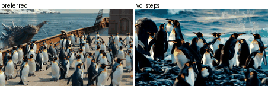
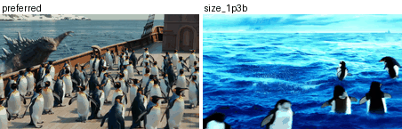
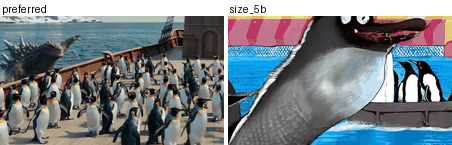
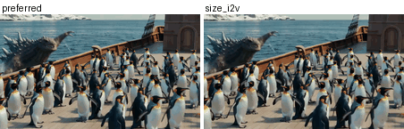
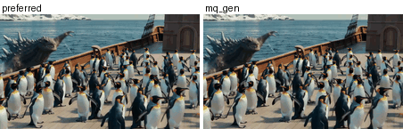
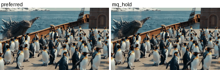
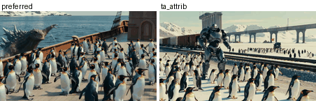

# IsoGen

Turn a text prompt into a pair of videos that differ in exactly one respect, so
the preference label follows from what was changed rather than from anyone
judging the result.

These are the eight interventions behind [IsoVRBench](../IsoVRBench) and its
training corpus. Prompts can come from anywhere; ours are VidProM. So can the
videos: the generators are a config field, and two families need no generator
at all.

This is the minimal version, written to show what each intervention does and to
be read in one sitting. One process, one prompt at a time, no parallelism, no
batching, and a model reloaded whenever the family changes, so most of the wall
time goes on loading rather than on sampling. The [scaling notes](#scaling-up)
say what to change.

## Install

```bash
pip install -r requirements.txt
```

`mq_hold` and `shuffle` rearrange the anchor's own frames and need only numpy,
pillow, pyyaml and imageio, so they run with torch absent. The other six
families load a generator on first use.

## Run it

```bash
# every family, from prompts
python generate.py --prompts example_prompts.txt --out pairs/

# only the two that need no model, on videos you already have, CPU is fine
python generate.py --anchors my_videos/ --out pairs/ --families mq_hold,shuffle
```

`example_prompts.txt` is one prompt per line, and any file in that form works. `--anchors` takes any directory of mp4
files from any generator, which is the point: the procedure is not tied to the
models below.

Output is one directory per prompt holding `anchor.mp4` and one clip per
family, plus `pairs.jsonl` with a record per pair.

## One prompt, one pair, in Python

```python
import torch
from diffusers import AutoencoderKLWan, WanPipeline

import config
import generate
import interventions as IV

cfg = config.load("benchmark")
model = "Wan-AI/Wan2.2-T2V-A14B-Diffusers"
vae = AutoencoderKLWan.from_pretrained(model, subfolder="vae",
                                       torch_dtype=torch.float32)
t2v = WanPipeline.from_pretrained(model, vae=vae,
                                  torch_dtype=torch.bfloat16).to("cuda")

prompt = "a hockey player skates with the puck"

anchor = t2v(prompt=prompt, height=cfg.height, width=cfg.width,
             num_frames=cfg.num_frames, num_inference_steps=cfg.steps,
             guidance_scale=cfg.guidance,
             generator=IV.seeded_generator(cfg)).frames[0]

# same model, same seed, fewer denoising steps: the pair isolates visual quality
degraded = IV.vq_steps(t2v, prompt, cfg)

generate.write(anchor, "anchor.mp4", cfg.fps)
generate.write(degraded, "vq_steps.mp4", cfg.fps)
# anchor is preferred, on visual quality
```

Rearranging an existing video needs no model at all, and runs without torch
installed:

```python
import config
import generate
import interventions as IV

cfg = config.load("benchmark")
frames = generate.read_frames("my_video.mp4")
reordered = IV.shuffle(frames, key="my_video", cfg=cfg)   # preferred: frames
stuttered = IV.mq_hold(frames, key="my_video", cfg=cfg)   # preferred: frames
generate.write(reordered, "shuffle.mp4", cfg.fps)
```

## The eight families

| family | what changes | label on | needs |
|---|---|---|---|
| `vq_steps` | fewer denoising steps, same prompt and seed | visual | the anchor model |
| `ta_attrib` | one attribute edited in the prompt, judged against the original | text | the anchor model |
| `size_1p3b` | a weaker generator renders the same prompt | overall | Wan2.1-T2V-1.3B |
| `size_5b` | a weaker generator renders the same prompt | overall | Wan2.2-TI2V-5B |
| `size_i2v` | a weaker generator continues the anchor's first frame | overall | Wan2.2-TI2V-5B |
| `mq_gen` | keyframes kept, gaps regenerated and snapped back | motion | Wan2.2-I2V-A14B |
| `mq_hold` | real frames held, giving stuttering motion | motion | nothing |
| `shuffle` | contiguous segments permuted | motion | nothing |

`ta_attrib` edits the prompt by looking up `triggers.json`, a frozen list of
1,116 trigger phrases with permitted replacements and the dimension each moves.
No model is involved in the edit, so it is deterministic.

## What they look like

One prompt, `Sea Monster attacking a ship full of penguins`, changed eight
ways. Left is the preferred clip in every pair.

**`vq_steps`** Fewer denoising steps. Same model, prompt and seed, so only visual quality moves.



**`size_1p3b`** A weaker generator renders the same prompt.



**`size_5b`** A different weaker generator, weak in its own way rather than more or less weak.



**`size_i2v`** A weaker generator continues the anchor's first frame.



**`mq_gen`** Keyframes kept, the gaps between them regenerated.



**`mq_hold`** Real frames of the anchor held, so the clip covers the same movement in jumps.



**`shuffle`** The anchor cut into six segments and reordered. Every pixel is the anchor's own.


**`ta_attrib`** Attributes edited in the prompt before rendering, here to `Desert Armoured cyborg attacking a freight train full of penguins`, then judged against the original.



These are downsampled and palette reduced so they load in a
README. The pairs themselves are in
[example_data/videos](../example_data/videos), and
`python example_data/previews.py` rebuilds these from them.

## Swapping the generator

Nothing about the interventions is tied to the four Wan checkpoints. They are a
mapping in `configs/*.yaml`:

```yaml
models:
  anchor: Wan-AI/Wan2.2-T2V-A14B-Diffusers
  weaker_t2v: Wan-AI/Wan2.1-T2V-1.3B-Diffusers
  ...
```

Point any entry at another checkpoint or a local directory and that family uses
it. Anything `diffusers` loads with `WanPipeline` drops in as is; another
architecture needs its pipeline class in `pipeline()`, which is a few lines.

**The size families need only a weaker generator.** There is nothing special
about 1.3B or 5B. The pair says the anchor's generator beats the other one, so
the only requirement is that `weaker_t2v` and `weaker_t2v_2` are worse than
`anchor`. Swap in whatever weaker model is at hand and the label still follows
from the construction. Using two of them, as here, is not a severity ladder;
the 1.3B and 5B models are differently weak rather than more and less weak.

**Or skip the generator entirely.** `--anchors` takes a directory of mp4 files
from any source, so the anchors can come from a model this repository has never
heard of. `mq_hold` and `shuffle` then need no model at all, and the four
families that re-render read the anchor off disk.

## Tuning

Every knob is a field in `configs/*.yaml`, and each one slides the pair along a
difficulty axis while the construction stays identical.

| knob | more degraded when | note |
|---|---|---|
| `vq_steps` | lower | 8 and 16 are about 13 points of model accuracy apart |
| `ta_attrib_k` | higher | more of the prompt is contradicted |
| `mq_hold_keyframes` | fewer | each frame is held longer |
| `mq_gen_keyframes` | fewer | motion drifts longer before snapping back |
| `shuffle_segments` | more | the order is scrambled finer |
| `shuffle_motion_min` | higher | keeps fewer, clearer pairs |
| `models` | a weaker `weaker_t2v` | widens the gap the size families carry |
| `num_frames` | fewer | affects every family; shortens segments and held runs |

`configs/benchmark.yaml` carries every field with its explanation and is what
IsoVRBench ships with. `configs/training.yaml` is layered on top of it and
lists only what it changes, which for the training corpus is `vq_steps` alone.
Copy either one and edit it:

```bash
python generate.py --prompts p.txt --out pairs/ --config my_settings.yaml
```

Or change a field without editing anything:

```bash
python generate.py --prompts p.txt --out pairs/ --set vq_steps=4 --set shuffle_segments=10
```

A misspelled key is an error rather than a silent default, and the resolved
settings are printed at the top of every run.

## Scaling up

**Generate every anchor first, then reuse it.** This is the change that matters.
The minimal version renders an anchor, applies a family, renders the anchor
again for the next prompt, and reloads a model whenever the family changes.
Splitting the work in two removes almost all of that. One pass renders every
anchor with the anchor model loaded once. Every family afterwards reads an
anchor off disk, and `mq_hold` and `shuffle` need nothing else at all, while
`size_i2v` and `mq_gen` need its frames rather than its prompt. The families
are independent once the anchors exist, so each becomes its own job.

Point every pass at the same `--out`. A family finds the anchor already there
and skips rendering it.

```bash
python generate.py --prompts example_prompts.txt --out pairs/ --families none
python generate.py --prompts example_prompts.txt --out pairs/ --families mq_gen
python generate.py --prompts example_prompts.txt --out pairs/ --families shuffle
```

**Shard by family, not by prompt.** Only one generator stays on the card, since
the anchor model is 14B and two at once do not fit in 80 GB. A worker running
one family loads its model once. A worker running every family for each prompt
reloads for every prompt, which is what the minimal version does and why it is
slow.

**Group families by what they need.** `mq_hold` and `shuffle` need no GPU and
can run on CPU nodes while the GPUs are busy. `size_1p3b` needs only a small
model. `mq_gen` is the expensive one, since it calls an image to video model
once per keyframe gap.

**Shard by prompt.** `--shard i --num-shards n` splits the prompt list, and
every worker owns a disjoint set of outputs, so no two ever write the same
file. Rerunning skips what exists, so a preempted shard costs only its
in-flight clip.

**Write atomically.** `generate.py` writes to a temporary name and renames,
because a clip truncated by preemption otherwise looks complete to the next
run. One 261-byte file that survived this way blocked 2,371 clips in our own
generation before we fixed it.
